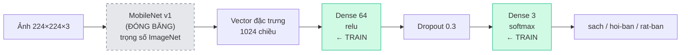

# 🤖 DabClean AI Module — Quét độ bẩn bằng AI (Transfer Learning)

Phân tích ảnh chụp căn phòng → trả về **điểm bẩn 0–100**, **phân loại**
(`sach` / `hoi-ban` / `rat-ban`) kèm **độ tin cậy từng loại**, và (tuỳ chọn)
**gợi ý giá dịch vụ**.

> Công nghệ: **TensorFlow.js (thuần JavaScript) + MobileNet v1 + Transfer Learning**

---

## 1. Vì sao dùng TensorFlow.js thuần JS?

| Vấn đề | Giải pháp |
|---|---|
| `@tensorflow/tfjs-node` **không có prebuilt binary cho Node 24** | Dùng `@tensorflow/tfjs` thuần JS |
| Máy **thiếu Visual Studio** để build tfjs-node từ source | Không cần build gì cả |
| Bản thuần JS **không có `tf.node.*`** (không đọc được ảnh) | Giải mã ảnh bằng `jpeg-js` / `pngjs` |
| Bản thuần JS **không có IO handler `file://`** (không lưu model ra file được) | Tự viết `src/ml/fsIOHandler.js` dùng `fs` |

> ⚠️ Cả 4 điểm trên đều đã **kiểm chứng thực tế** trong quá trình làm, không phải giả định:
> - `typeof tf.node` → `undefined`
> - `tf.io.getSaveHandlers('file:///x')` → `[]` (rỗng)
> - `model.save('file://...')` → lỗi `Cannot find any save handlers`

---

## 2. Nguyên lý Transfer Learning đang dùng

### Ý tưởng

**MobileNet v1** đã được huấn luyện sẵn trên **ImageNet** (1.2 triệu ảnh, 1000 lớp).
Nhờ đó nó đã "biết nhìn": nhận ra cạnh, góc, hoa văn, kết cấu bề mặt, vật thể…

Ta **không train lại** MobileNet (đó là phần tốn kém nhất và cần dữ liệu khổng lồ).
Thay vào đó ta **tái sử dụng** nó làm **bộ trích đặc trưng**, rồi chỉ train
một "cái đầu" nhỏ của riêng mình cho bài toán 3 lớp.



### ⚠️ Điểm quan trọng: "cắt lớp cuối" được thực hiện thế nào

Cách làm transfer learning **thông thường** trên Keras/TensorFlow Python là:

```python
base = MobileNet(weights='imagenet', include_top=False)  # bỏ lớp phân loại
model = Sequential([
    base,
    Dense(64, activation='relu'),
    Dense(3, activation='softmax')
])
```

**Nhưng cách này KHÔNG dùng được ở đây**, vì gói `@tensorflow-models/mobilenet`
trả về một **`tf.GraphModel`**, không phải `tf.LayersModel`:

```
base.layers     → undefined   ❌ không truy cập được từng lớp
base.getLayer   → undefined   ❌ không cắt/ghép lớp được
```

Nên ta làm **tương đương về mặt toán học**:

1. Gọi `mobilenet.infer(ảnh, true)` → trả về **vector 1024 chiều** ở lớp
   global pooling, tức **đầu ra ngay trước lớp softmax 1000 lớp của ImageNet**.
   *Đây chính là việc "cắt bỏ lớp cuối".*
2. Vector 1024 chiều đó là **input** cho 2 lớp Dense của ta.

Kết quả là cùng một mạng:

$$\text{ảnh} \xrightarrow{\text{MobileNet (đóng băng)}} \vec{v} \in \mathbb{R}^{1024} \xrightarrow{\text{Dense}_{64,\text{relu}}} \xrightarrow{\text{Dense}_{3,\text{softmax}}} \text{xác suất}$$

### Lợi ích phụ: nhanh hơn hàng chục lần

Vì MobileNet chạy **một lần duy nhất cho mỗi ảnh** (trích đặc trưng), quá trình
train chỉ phải cập nhật 2 lớp Dense nhỏ (~65.795 tham số) trên backend CPU thuần JS.

Nếu chạy lại MobileNet mỗi epoch, thời gian sẽ tăng gấp hàng chục lần.

### Tại sao có Dropout?

Dataset nhỏ (vài chục ảnh/lớp) nên rất dễ **overfit** — model học thuộc lòng ảnh
train nhưng kém với ảnh mới. `Dropout(0.3)` tắt ngẫu nhiên 30% neuron khi train,
buộc mạng học đặc trưng tổng quát hơn.

---

## 3. Cài đặt & chạy

```bash
cd ai-module
npm install
cp .env.example .env      # Windows: copy .env.example .env
```

### Bước 1 — Chuẩn bị dataset

```
ai-module/
  dataset/
    sach/       ảnh phòng sạch       (nên ≥ 30 ảnh)
    hoi-ban/    ảnh phòng hơi bẩn    (nên ≥ 30 ảnh)
    rat-ban/    ảnh phòng rất bẩn    (nên ≥ 30 ảnh)
```

> ⚠️ **Dataset tổng hợp đã bị gỡ bỏ.** Module này nay chỉ dùng **ảnh thật**.
> Model hiện tại được train từ **597 ảnh thật** (sach 200 / hoi-ban 198 / rat-ban 199).

### Bước 2 — Huấn luyện

```bash
npm run train
# hoặc tuỳ chỉnh:
node train.js --epochs 60 --batch 16

# Chỉ định dataset ở nơi khác:
node train.js --dataset "D:\folder anh\dataset" --out "./model-do-ban2" --epochs 40 --batch 32
```

Kết quả: model lưu vào `model-do-ban2/` gồm `model.json`, `weights.bin`, `metadata.json`.

### Bước 3 — Đánh giá chất lượng model (tuỳ chọn)

```bash
npm run evaluate
# hoặc: node test/evaluate.js --dataset "D:\folder anh\dataset" --sample 30
```

In ra độ chính xác, ma trận nhầm lẫn, điểm trung bình mỗi lớp và danh sách ảnh đoán sai.
⚠️ Đây là đánh giá **lạc quan** vì ảnh đã dùng để train — muốn khách quan cần bộ test riêng.

### Bước 4 — Dự đoán

```bash
node predict.js anh-phong.jpg
node predict.js anh1.jpg anh2.jpg
```

### Bước 4 — Chạy server

```bash
npm start
```

| Mục | URL |
|---|---|
| 🎨 Giao diện demo | `http://localhost:5100` |
| ❤️ Health check | `http://localhost:5100/api/ai/health` |
| 📋 Thông tin model | `http://localhost:5100/api/ai/model-info` |

---

## 4. API

### `POST /api/ai/scan` — quét độ bẩn

| Field | Kiểu | Bắt buộc | Mô tả |
|---|---|---|---|
| `image` | file | ✅ | Ảnh phòng (jpeg/png/webp/bmp/gif, ≤ 10MB) |
| `images` | file[] | ✅ (thay `image`) | Gửi nhiều ảnh (tối đa 10) để lấy trung bình |

**Ví dụ:**

```bash
curl -X POST http://localhost:5100/api/ai/scan -F "image=@phong.jpg"
```

**Kết quả:**

```json
{
  "success": true,
  "data": {
    "diem": 89.6,
    "phanLoai": "rat-ban",
    "doTinCay": { "sach": 0.0001, "hoiBan": 0.0086, "ratBan": 0.9913 },
    "phanLoaiHienThi": "Rất bẩn",
    "mauSac": "#EF4444",
    "soAnh": 1
  }
}
```

Khi gửi nhiều ảnh, có thêm `ketQuaTungAnh[]` với chi tiết từng ảnh.

### `POST /api/ai/estimate` — quét + báo giá

Thêm các field tuỳ chọn: `areaSize`, `urgency`, `extras`.

```bash
curl -X POST http://localhost:5100/api/ai/estimate \
  -F "image=@phong.jpg" -F "areaSize=70" -F "urgency=soon" -F "extras=mold"
```

### `GET /api/ai/model-info` — trạng thái model

```json
{
  "success": true,
  "data": {
    "trained": true,
    "metadata": { "labels": ["sach","hoi-ban","rat-ban"], "finalValAccuracy": 1 }
  }
}
```

> Nếu model chưa train, `/scan` và `/estimate` trả **503** kèm
> `code: "MODEL_NOT_TRAINED"`.

---

## 5. Quy đổi xác suất → điểm 0–100

Mỗi lớp có một **điểm neo**:

| Lớp | Điểm neo |
|---|---|
| `sach` | 10 |
| `hoi-ban` | 50 |
| `rat-ban` | 90 |

Điểm cuối là **trung bình có trọng số theo xác suất softmax**:

$$\text{điểm} = 10 \cdot p_{\text{sạch}} + 50 \cdot p_{\text{hơi bẩn}} + 90 \cdot p_{\text{rất bẩn}}$$

Nhờ vậy điểm biến thiên **mượt** (ví dụ 60% sạch + 40% hơi bẩn → ~26 điểm)
thay vì nhảy bậc thô.

---

## 6. Cấu trúc thư mục

```text
ai-module/
├── server.js                     # Khởi chạy Express
├── train.js                      # ⭐ Huấn luyện (transfer learning)
├── predict.js                    # ⭐ Dự đoán (CLI + module)
├── src/
│   ├── app.js                    # Express app
│   ├── ml/
│   │   ├── backbone.js           # MobileNet đóng băng + trích embedding
│   │   ├── modelFactory.js       # ⭐ 2 lớp Dense (64 relu + 3 softmax)
│   │   ├── dataset.js            # Đọc dataset -> tensor embedding
│   │   ├── imageUtils.js         # Giải mã ảnh (jpeg-js/pngjs) -> tensor
│   │   ├── fsIOHandler.js        # ⭐ Tự viết IO handler lưu model ra file
│   │   └── labels.js             # Nhãn + quy đổi điểm
│   ├── config/businessRules.js   # Quy tắc giá & mức độ bẩn
│   ├── pricing/priceCalculator.js# Tính giá dịch vụ
│   └── routes/aiRoutes.js        # API endpoints
├── public/index.html             # Giao diện demo
├── test/evaluate.js              # Đánh giá model (độ chính xác, ma trận nhầm lẫn)
└── model-do-ban2/                # Model sau khi train (đã commit, 257 KB)
```

---

## 7. Tinh chỉnh

### Tham số train

```bash
node train.js --epochs 60 --batch 16 --split 0.2 --units 64 --dropout 0.3 --lr 0.001
```

| Tham số | Mặc định | Ý nghĩa |
|---|---|---|
| `--epochs` | 40 | Số vòng huấn luyện |
| `--batch` | 16 | Kích thước lô |
| `--split` | 0.2 | Tỉ lệ validation |
| `--units` | 64 | Số unit lớp Dense 1 |
| `--dropout` | 0.3 | Tỉ lệ dropout |
| `--lr` | 0.001 | Learning rate |
| `--dataset` | `./dataset` | Thư mục dataset |
| `--out` | `./model-do-ban2` | Thư mục lưu model |

### ⚠️ Thứ tự nhãn là bất biến

`src/ml/labels.js` định nghĩa thứ tự:

```
index 0 → sach
index 1 → hoi-ban
index 2 → rat-ban
```

Thứ tự này quyết định ý nghĩa xác suất của lớp softmax.
**Nếu đổi thứ tự, PHẢI train lại model.**

---

## 8. Tích hợp vào dự án chính

1. Copy thư mục `ai-module/` vào repo chính.
2. Chạy song song backend chính (5000) và AI module (5100).
3. Trong `booking.html`, gọi API khi khách tải ảnh:

```js
const form = new FormData();
form.append('image', fileInput.files[0]);
const res = await fetch('http://localhost:5100/api/ai/scan', {
  method: 'POST', body: form
});
const { data } = await res.json();
// data.diem        -> 89.6
// data.phanLoai    -> "rat-ban"
// data.doTinCay    -> { sach, hoiBan, ratBan }
```

---

## 9. Lưu ý

- Model hiện tại train từ **597 ảnh phòng thật** (sach 200 / hoi-ban 198 / rat-ban 199).
  Độ chính xác đo trên mẫu 90 ảnh: **96.7%** (Sạch 100%, Hơi bẩn 100%, Rất bẩn 90%).
- Backend CPU thuần JS: trích đặc trưng ~1.8s/ảnh, predict ~5–20s/ảnh
  (lần đầu chậm hơn do nạp MobileNet).
- Ảnh xử lý **trong RAM**, không lưu ra đĩa.
- **Git:** `model-do-ban2/` (257 KB) ĐƯỢC commit để ai clone cũng chạy được ngay.
  `dataset/` KHÔNG commit vì nặng (~174 MB) — cần tự chuẩn bị ảnh rồi train.
  (Kiểm tra bằng `git check-ignore -v <đường-dẫn>` nếu không chắc.)
